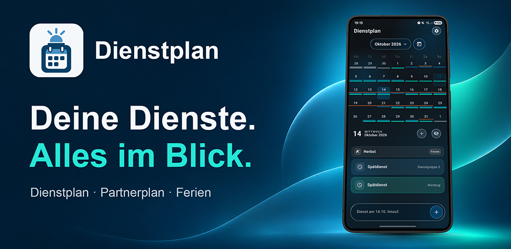

# Dienstplan — police duty schedule app

[](https://flutter.dev)
[](LICENSE)
[](https://github.com/lusu007/dienstplan)



Your duties, partner schedule, and holidays at a glance. Dienstplan is a German-language Flutter app for Android and iOS that helps police officers keep track of their shifts and personal appointments. Duty schedules are generated locally and remain available offline.

## Download

<p>
  <a href="https://apps.apple.com/app/dienstplan/id6748340130"></a>
  <a href="https://play.google.com/store/apps/details?id=io.scelus.dienstplan"></a>
</p>

[Download Android APKs](https://github.com/lusu007/dienstplan/releases) · [Changelog](CHANGELOG.md)

## Features

- **Duty calendar:** month and year navigation, a jump to today, a compact view, and daily duty details with filters for duty groups. Other duty groups can be shown or hidden in the compact list.
- **Local rotations:** schedules generated from bundled JSON configurations. Available plans cover Einsatz- und Streifendienst and Bereitschaftspolizei in Bremen, Lehe/Geestemünde and Leherheide in Bremerhaven, and a general two-shift, five-day rotation.
- **Partner schedule:** display a partner's configured rotation alongside your own, with separate duty groups and accent colors.
- **Personal entries:** add appointments and duties through the quick-entry field or add button; edit or delete them later. Entries support all-day or timed events and optional notes.
- **Holidays:** enable school and public holidays for a selected German federal state, choose their accent color, and refresh the data manually. Data comes from [Mehr-Schulferien.de](https://www.mehr-schulferien.de/) and requires internet access to fetch.
- **Calendar export:** share, save, or open duties as an `.ics` file for a chosen date range, optionally including the partner schedule.
- **Liquid Glass design:** shared glass surfaces, light and dark themes, a system theme option, and settings grouped by schedule, partner, appearance, holidays, and app/privacy.
- **Local storage and privacy controls:** duty schedules and personal entries are stored on the device. Sentry analytics/error reporting and session recording can be controlled separately in settings.
- **App tools:** contact the developer with an optional screenshot, share the app, revisit update highlights, view privacy information and third-party licenses, or reset app data.

## Getting started

1. Choose your duty schedule and duty group during setup; optionally add a partner schedule and choose a theme.
2. Select a calendar day to see its duties. Use the quick-entry field or add button to create your own appointment or duty.
3. Open **Einstellungen** to adjust **Mein Dienstplan**, **Partner Dienstplan**, **Darstellung**, **Ferien & Feiertage**, or **App & Datenschutz**.
4. To export your duties, open **Mein Dienstplan → Kalender exportieren**, choose a date range, and share, save, or open the `.ics` file.

## Run from source

Use Flutter **3.47.6**, the version pinned in the project's CI workflows. It bundles Dart **3.13.5**; `pubspec.yaml` declares a Dart constraint of `>=3.13.0 <4.0.0`. This documents the project's toolchain; see the [official SDK archive](https://docs.flutter.dev/install/archive) for newer Flutter releases.

For Android, install the Android SDK and JDK 25 (used in CI and by the Gradle toolchain), then connect a device or start an emulator. Check your setup with `flutter doctor`.

```bash
git clone https://github.com/lusu007/dienstplan.git
cd dienstplan
flutter pub get
flutter run
```

On Android, `flutter run` uses the default `dev` flavor. iOS development requires macOS and Xcode; the repository includes `Dienstplan-Dev` and `Dienstplan-Prod` schemes. See the [iOS configuration guide](docs/ios_xcode_configuration.md) for setup.

Production APKs require release signing. The [Android release workflow](.github/workflows/android-release.yml) shows the required keystore and signing setup. Once configured:

```bash
flutter build apk --flavor prod --release
```

## Development

- **Toolchain reference:** [lint workflow](.github/workflows/lint.yml), [Android release workflow](.github/workflows/android-release.yml), and [iOS release workflow](.github/workflows/ios-release.yml).
- **Codegen:** `dart run build_runner build --delete-conflicting-outputs` after changing Freezed / Riverpod / routes.
- **Architecture:** domain / data / presentation layers, with Riverpod for state management and dependency injection. Shared infrastructure lives in `lib/core`; providers live in `lib/core/di/riverpod_providers.dart` (generated `.g.dart` alongside).
- **Schedules:** rotation definitions live in [assets/schedules/](assets/schedules/).
- **UI:** shared glass components and conventions are documented in the [design and style guide](docs/style_guide/README.md).
- **Checks:** `flutter analyze` and `flutter test`.
- **Details:** workflow, standards, and deeper architecture notes are in [CONTRIBUTING.md](CONTRIBUTING.md).

## Contributing

Fork, create a branch such as `feat/your-feature` or `fix/your-fix`, run the checks, and open a PR. Use Conventional Commit messages such as `feat: add calendar option`. See [CONTRIBUTING.md](CONTRIBUTING.md) and the [Code of Conduct](CODE_OF_CONDUCT.md).

## License

[AGPL-3.0](LICENSE).

## Acknowledgments

School/public holiday data via [Mehr-Schulferien.de](https://www.mehr-schulferien.de/) ([GitHub](https://github.com/mehr-schulferien-de/www.mehr-schulferien.de)). Third-party licenses are listed in the in-app About screen.

## Support

Maintained by [Lukas Jost](https://github.com/lusu007). Report [bugs and feature requests](https://github.com/lusu007/dienstplan/issues) or ask questions in [GitHub Discussions](https://github.com/lusu007/dienstplan/discussions).

In the app, use **Einstellungen → App & Datenschutz → Kontakt** to send feedback. This uses Sentry and requires **Analysen & Fehlerberichte** to be enabled. The [privacy policy](assets/legal/datenschutz.md) is also available in the app.
